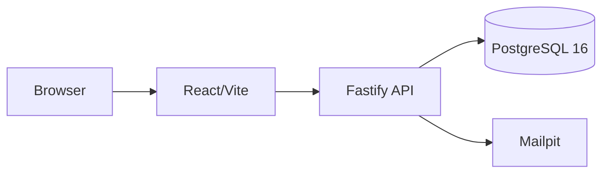

# Brightloop Subscription Management System

Brightloop is a subscription operations and recurring-billing platform for products, plans, invoicing, payments, dunning, customer self-service and finance analytics.

## Quick Start

```bash
docker compose up --build
docker compose exec api npm run seed:demo
open http://localhost:5173
```

API documentation: `http://localhost:3001/docs`. Mailpit: `http://localhost:8025`.
Docker is required for PostgreSQL 16 and the complete application stack.

## Architecture



- `apps/api` - Fastify domains and PostgreSQL integration
- `apps/web` - React/Vite administration and portal UI
- `packages/shared` - shared contracts
- `infra/postgres` - migrations and Docker initialization

## Verification

```bash
make test
make story
make bench
```
